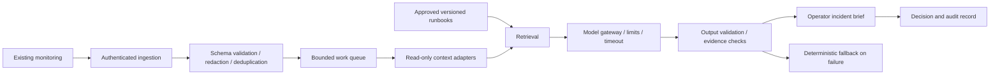

# Leaf Solutions — IT Operations Agent

**A Leaf Solutions initiative · Pre-MVP · Offline deterministic demo · No AI agent implemented**

Leaf Solutions IT Operations Agent is a proposed operations assistant for small IT teams managing hybrid server environments. It aims to turn monitoring alerts and approved operational knowledge into concise incident briefs, evidence-backed diagnostic hypotheses, and suggested runbooks.

The initial planning scenario is **50 servers**. This is a sizing assumption, not a tested capacity claim. Leaf Solutions is the project umbrella supplied by the project owner; this repository does not establish incorporation, trademark ownership, or commercial availability.

## Current status

This repository contains planning documentation, a financial calculator, and a working offline demonstration that produces incident reports from synthetic disk alerts using deterministic rules. There is no AI agent, monitoring integration, model connection, server action executor, authenticated review system or production deployment. The product capabilities below remain planned. No production readiness, customer results, certification, or guaranteed savings are claimed.

## Problem and proposed approach

Small operations teams repeatedly gather host context, correlate noisy alerts, and search for the right runbook. Leaf Solutions IT Operations Agent would complement an existing monitoring stack rather than require its replacement. The MVP would:

1. Receive authenticated alerts from one monitoring integration.
2. Normalize and deduplicate events without hiding the original evidence.
3. Retrieve approved runbooks and bounded, read-only host context.
4. Produce a structured incident brief with evidence references, uncertainty, and next checks.
5. Let an operator accept, reject, or amend recommendations and record the decision.

The MVP will have no infrastructure write credentials. Approved execution of allowlisted runbooks is a separate future milestone, requiring additional security review and pilot evidence.

## Example workflow — illustrative only

A disk utilization alert arrives for a synthetic Linux host. The proposed assistant links recent metrics and the approved disk triage runbook, suggests read-only checks, and identifies missing evidence. The operator remains responsible for deciding what to do. The assistant must never infer permission to delete files or restart a service from the alert text.

See [synthetic input](examples/disk-alert.json) and [illustrative output](examples/incident-brief.md). These are hand-authored design fixtures, not output from an implemented agent.

## Run the offline demonstration

Python 3 standard library only; no credentials, packages or network access required:

```sh
python3 demo/triage.py
python3 -m unittest discover -s tests -v
```

Open the generated [HTML report](demo/output/incident.html), or inspect [Markdown](demo/output/incident.md) and [structured JSON](demo/output/incident.json). Checked-in outputs are reproducible synthetic samples. See [demo usage and limitations](demo/README.md), including how to annotate an operator review.

## Proposed architecture



The diagram describes the proposed production architecture; the offline demo implements only bounded file validation, fixed runbook selection and deterministic reporting. There is no execution path to managed servers in the MVP. See [architecture and boundaries](docs/ARCHITECTURE.md).

## Documentation

| Document | Purpose |
| --- | --- |
| [MVP roadmap](docs/ROADMAP.md) | Scope, milestones, acceptance gates, evaluation |
| [Architecture](docs/ARCHITECTURE.md) | Data flow, contracts, decisions, failure handling |
| [50-server assumptions](docs/ASSUMPTIONS.md) | Workload, staffing, retention, unresolved questions |
| [Competitive analysis](docs/COMPETITIVE_ANALYSIS.md) | Source-backed alternatives and positioning hypotheses |
| [Financial analysis](docs/FINANCIAL_ANALYSIS.md) | Costs, sensitivity, ROI, development and pricing hypotheses |
| [Security](SECURITY.md) | Threat model, privacy, access controls, incident response |
| [Maintenance](docs/MAINTENANCE.md) | Ownership, cadence, backups, updates, support boundaries |
| [Publication](docs/PUBLISHING.md) | GitHub findings and publication steps |
| [Portfolio copy](docs/PORTFOLIO.md) | Honest English copy for later rodrigo-it-site integration |

## Reproduce the financial scenario

Python 3 standard library only:

```sh
python3 tools/financial_model.py
```

The script calculates planning estimates; it does not monitor hosts or perform AI inference. There are no installation or deployment instructions for an agent because none exists yet.

## Contributing and governance

Start with [CONTRIBUTING.md](CONTRIBUTING.md). Proposed project owner: Rodrigo Salamanca. Security, operations, and commercial ownership must be assigned before a pilot. Technology choices and delivery dates remain provisional.

No open-source license has been selected. Do not assume reuse rights beyond applicable law or permission from the rights holder. A license and verified rights holder must be established before accepting external code contributions.

Documentation baseline: 2026-10-13. Research sources and assumptions are recorded in the linked documents.
