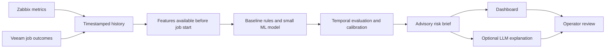

# Backup failure prediction — proposed first pilot

North Maple Systems — IT Operations Agent. Updated 2026-10-14.

**Design only:** no trained model, live connectors, calibrated probabilities or deployed prediction service exist. The website dashboard and earlier disk demo use synthetic scenarios.

## Target and simplest implementation

Start with Zabbix + Veeam and ask: “Will the next scheduled backup job fail?” Define failure with the customer: failed completion versus warning, retry or missed schedule. Fix the prediction timestamp before job start and record the expected outcome window. A failed backup is the target; it is not proof of data loss or recovery failure.

Begin with approved CSV/report exports. Add scoped read-only APIs after confirming product editions, licenses, endpoints and permissions. Use a scheduled Python process and a central database; PostgreSQL is a candidate. No GPU, streaming platform or large model is required as the starting design. Size the infrastructure after measuring workload.

## Data contract

One training row per scheduled job execution: stable asset/job IDs, prediction timestamp in UTC, expected start, source references, pre-start metric summaries, missingness/freshness flags and final outcome recorded later. Candidate inputs: prior job durations and errors, prior failures/retries, free backup-repository space, storage latency and server load. Join assets carefully and verify clock alignment.

Include successful jobs as well as failures. Exclude final status, error messages and duration of the job being predicted from its inputs. Use only observations available at prediction time. Keep intervention records: a prevented failure must not automatically be counted as a false alarm or confirmed success. A CSV alone is insufficient if it lacks usable history or negative examples.

## Model and evaluation

Compare existing monitoring and simple rules with logistic regression and a small tree-based candidate in scikit-learn. Fit preprocessing on training data only. Train on earlier periods, tune on a later validation period and report once on an untouched subsequent test period. Keep overlapping outcome windows out of split boundaries and review generalization across assets. No universal minimum history duration or incident count is promised: inspect usable failures, seasonality and data coverage first.

Report incident-level recall, warning precision, false warnings per week, lead-time distribution, missing/stale-data coverage and operator review time. Group repeated warnings for the same job. Accuracy alone is misleading when failures are rare. Calibrate numerical probabilities on independent validation data and check reliability; otherwise show an explicitly unvalidated score or abstain. Select alert thresholds with operators according to the cost of missed failures and investigation burden.

Shadow mode preserves current alerts and makes no infrastructure changes. Expansion requires better operational usefulness than the agreed baseline, acceptable alert burden, security approval and measured costs. Stop, narrow the target or collect more history if these gates fail.

## 50-server planning assumptions

50 servers is the potential estate, not an initial rollout or capacity guarantee. Begin with a representative subset and relevant backup jobs. Record jobs per server/day, metric sampling, feature count, lookback, retention, export size and replay load before sizing. Estimate storage as rows/day × retained days × measured row size plus indexes/backups. Batch scoring may run before scheduled jobs; polling cadence must match the agreed horizon.

Costs must include integration work, labeling, historical evaluation, hosting/database, backups, maintenance, operator review and optional LLM usage. Existing platform licenses are baseline costs; incremental licenses and API entitlements must be listed separately. Prior diagnostic economics and website investigation-time examples do not establish predictive ROI or a price quote.

## LLM and roadmap boundary

The statistical model estimates risk; an optional LLM explains approved evidence and answers questions. It neither establishes prediction accuracy nor authorizes changes. Zabbix native forecast/timeleft remains suitable for simple threshold extrapolation. Wazuh, Fortinet, Intune, cloud and ticket sources are later candidates, conditional on usefulness and permission. No autonomous remediation is in this pilot.

## References

- [Zabbix predictive functions](https://www.zabbix.com/documentation/current/en/manual/appendix/functions/prediction)
- [scikit-learn logistic regression](https://scikit-learn.org/stable/modules/generated/sklearn.linear_model.LogisticRegression.html)
- [scikit-learn temporal splitting](https://scikit-learn.org/stable/modules/generated/sklearn.model_selection.TimeSeriesSplit.html) — a custom time split may be needed for irregular job schedules.
- [scikit-learn probability calibration](https://scikit-learn.org/stable/modules/calibration.html)
